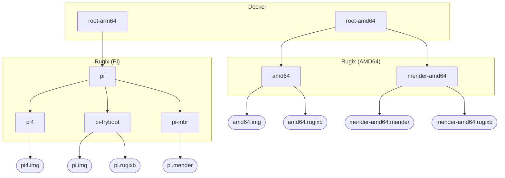

# umbrelOS

## Kernel

The amd64 and generic arm64 images take a newer kernel and firmware from
trixie-backports, pinned to their own snapshot date
(`KERNEL_BACKPORTS_SNAPSHOT_DATE`) separate from the rest of the system
(`APT_SNAPSHOT_DATE`). Generic arm64 is used for dev VMs, and runs the same
kernel so it matches what amd64 devices run. The Raspberry Pi image uses the
Raspberry Pi kernel and is unaffected. An apt pin takes every package built from
these source packages from backports:

- **Kernel:** `linux`, `linux-signed-amd64`, `linux-signed-arm64` and
  `linux-base`.
- **Firmware:** `firmware-nonfree`, so newer in-tree drivers find the firmware
  they ask for.

Everything else, including ZFS and microcode, stays on trixie. The pin persists
in the image, so later build steps follow it too. If a future backports kernel
or firmware depends on another backports package, the build fails until its
source package is added to the pin.

trixie's 6.12 kernel only gets fixes, so hardware released after it often needs
out-of-tree drivers or doesn't work at all. Backports follows newer upstream
kernels, so new NICs, GPUs, Wi-Fi chips and platforms are supported in-tree. For
example, the in-tree `r8169` driver handles RTL8125D rev B, RTL8125BP/CP/K and
RTL8127A, so the image ships no out-of-tree Realtek drivers.

The amd64 build fails if:

- the kernel is missing a config option the GPU stack depends on;
- the NVIDIA kernel module didn't build for the kernel at the pinned driver
  version.

### Bumping the kernel

Backports picks up a new kernel series about every two months. To bump, update
`KERNEL_BACKPORTS_SNAPSHOT_DATE` and check:

- **ZFS builds against it.** trixie's ZFS refuses kernels newer than its
  upstream `Linux-Maximum` (7.2 for 2.3.9), so the build fails once backports
  moves past that. trixie rarely updates ZFS, so the fix is to add `src:zfs-linux`
  to the pin and take ZFS from backports too.
- **NVIDIA's DKMS module still builds against it.**
- **Existing pools import and ZFS works on real hardware**, along with
  networking, GPUs and anything else the new kernel's drivers touch.

### ZFS from backports

Once ZFS comes from backports, also check:

- **The backports ZFS supports the kernel.** Debian builds backports ZFS with
  `--enable-linux-experimental`, so it builds against kernels upstream hasn't
  validated. A successful build proves nothing: compare `Linux-Maximum` in
  `/usr/src/zfs-*/META` with the kernel version. Backports kernels sometimes
  land before a supporting ZFS (7.1 ran four weeks ahead), so pick a snapshot
  date where they line up. On amd64 the kernel comes from `linux-signed-amd64`,
  which reaches backports a week or more after `linux`.
- **New pool features.** Backports follows the newest OpenZFS major version.
  umbrelOS creates pools with `compatibility=openzfs-2.3`, so a newer ZFS
  doesn't enable features that would stop a pool importing after an OTA
  rollback. Existing pools aren't upgraded automatically.

### Raspberry Pi

The Raspberry Pi image takes only its boot and hardware support from the
Raspberry Pi apt repo, the packages built from these source packages:

- **Kernel:** `linux`, the Pi 4 (`rpi-v8`) and Pi 5 (`rpi-2712`) kernels.
- **Boot firmware:** `raspi-firmware`, which also installs the kernels and
  initramfs into the boot partition.
- **Wi-Fi firmware:** `firmware-nonfree`, for `firmware-brcm80211`.
- **initramfs:** `initramfs-tools`, patched to build an initramfs for every Pi
  kernel flavour.
- **WPA3:** `wpa`, for `wpasupplicant`. Debian's doesn't report SAE support on
  the Pi's `brcmfmac` Wi-Fi, so NetworkManager can't join WPA3-only networks.

The rest of the system comes from the Debian snapshot as on other platforms.
The Raspberry Pi repo rebuilds many Debian packages (glibc, ffmpeg, mesa,
NetworkManager...) with higher versions, so if it were an apt source they'd
replace Debian's in every later build step.

The Raspberry Pi repo has no snapshots and its index only lists the latest
version of each package, so installing from it would make Pi builds take
whatever it serves at build time. To keep them reproducible like the rest of
the image, the build doesn't add it to apt. It installs the exact packages
listed in `build-steps/setup-raspberrypi/packages.sha256` from the repo's
pool, checked against their checksums. To update them, run
`./update-raspberrypi-packages.sh`. It resolves the packages against the
current repo, with `raspberrypi.pref` limiting which ones come from it, and
rewrites the list.

## GPU acceleration

The amd64 image keeps GPU userspace in application containers while providing
the host kernel interfaces those runtimes require:

| Hardware/backend | Host support | Container support |
| --- | --- | --- |
| AMD Vulkan | In-tree `amdgpu`, `/dev/dri` | Mesa/RADV |
| AMD ROCm | In-tree `amdgpu`/KFD, `/dev/kfd` and `/dev/dri` | ROCm/HIP |
| NVIDIA Vulkan | NVIDIA open kernel module, Vulkan ICD, NVIDIA Container Toolkit | Vulkan application/runtime |
| NVIDIA CUDA | NVIDIA open kernel module, `libcuda`, NVIDIA Container Toolkit | CUDA runtime |
| NVIDIA video | NVIDIA open kernel module, NVDEC/NVENC libraries, NVIDIA Container Toolkit | Video application/runtime |

NVIDIA's Vulkan, CUDA, and video implementations share the NVIDIA kernel driver
and can be used simultaneously. They coexist with AMDGPU and RADV on mixed-GPU
systems; the Vulkan loader selects the ICD matching each device. Containers
using NVIDIA Vulkan must request the `graphics` NVIDIA driver capability,
expose `/dev/dri`, and include the Vulkan and GLVND EGL loaders (`libvulkan1`
and `libegl1` on Debian-based images). Containers using NVDEC or NVENC must
request the `video` NVIDIA driver capability and include a compatible video
application such as FFmpeg.

An image that only needs Vulkan acceleration on NVIDIA hardware can set the
`NVIDIA_CUDA_SUPPORT=false` build argument to omit the NVIDIA host packages and
use the in-tree `nouveau` driver with containerized Mesa/NVK instead. NVK cannot
drive a GPU while that GPU is bound to the NVIDIA kernel driver.


## Build Process

The following diagram visualizes the build process and possible build artifacts:



### Reproducible Builds

Building the same commit produces bit-for-bit identical amd64, arm64 and
Raspberry Pi images (`umbrelos-amd64.img`, `umbrelos-arm64.img`,
`umbrelos-pi.img`, `umbrelos-pi4.img`), update bundles (`umbrelos-amd64.update`,
`umbrelos-arm64.update`, `umbrelos-pi.update`), compressed images
(`umbrelos-amd64.img.xz`, `umbrelos-pi.img.zip`), USB installer
(`umbrelos-amd64-usb-installer.iso`) and multi-arch Docker image, on any
machine. Anyone can rebuild a release and check it against its signed
`manifest.txt`, which pins every file by SHA-256:

```sh
git clone https://github.com/getumbrel/umbrel.git && cd umbrel
git checkout <commit> # The release manifest's Commit:
cd packages/os
npm run build:amd64 <version>
cd ../..
./scripts/release-signing verify https://download.umbrel.com/release/<version>/ --files packages/os/build
```

And the Docker image against the manifest's `Docker-Image:` digest:

```sh
SKIP_ROOTS=true SKIP_RUGIX_ARTIFACTS=true \
    DOCKER_IMAGE_OUTPUT=type=oci,dest=build/umbrelos-docker.tar ./build.sh
tar -xOf build/umbrelos-docker.tar index.json | jq -r '.manifests[0].digest'
```

The compressed images and USB installer are made from the images, the same way
the release job makes them. Build the installer with an empty Nix store, since
one left by an older build may hold store paths built without Nix's sandbox,
which differ:

```sh
npm run build:pi <version>
(cd build && TZ=UTC zip -X umbrelos-pi.img.zip umbrelos-pi.img)
npm run build:amd64:usb-installer:prepare # Writes build/umbrelos-amd64.img.xz
docker volume rm umbrelos-usb-installer-nix
npm run build:amd64:usb-installer
shasum -a 256 build/umbrelos-pi.img.zip build/umbrelos-amd64.img.xz \
    build/umbrelos-amd64-usb-installer.iso
```

Building from a clean checkout matters: untracked files in the repo end up in
the build context. To build from a source archive without Git history, set
`SOURCE_DATE_EPOCH` to the release commit's time (`git log -1 --format=%ct
<version>`), which the build otherwise reads from Git.

Raspberry Pi builds also need the Raspberry Pi repo to still serve the exact
packages they pin (see [Raspberry Pi](#raspberry-pi)). It has kept old packages
in its pool so far, but it isn't an archive like snapshot.debian.org.

How the build stays reproducible:

- **Inputs are pinned.** Base images by digest, apt packages by
  snapshot.debian.org date, everything downloaded from elsewhere (including
  the Raspberry Pi kernel and firmware) by checksum, and BuildKit and Rugix
  Bakery by digest.
- **Time is fixed.** Build steps see a fixed `SOURCE_DATE_EPOCH` (set in
  `umbrelos.Dockerfile`), so tools that record the current time, like user
  creation and initramfs generation, record that instead. Exported files are
  dated by the commit time. Keep the Dockerfile value fixed and in the past:
  changing it invalidates the layer cache, and the Docker image export only
  clamps timestamps newer than it.
- **The checkout doesn't leak in.** The `source` stage normalizes the modes and
  mtimes of files copied from the repo, which otherwise depend on the umask
  and on when each file was checked out.
- **Generated state is removed or fixed.** Logs, caches, SSH host keys,
  machine and host IDs, and DKMS's module signing key (modules are left
  unsigned, umbrelOS doesn't use Secure Boot) would otherwise differ on every
  build.
- **Nothing depends on the build machine.** Its CPU, kernel and filesystem
  differ between machines (Rosetta on Apple Silicon reports an ARM CPU to
  amd64 builds), so build steps mustn't look at them. For example, the AMD
  microcode is always included in the initramfs rather than only when building
  on an AMD CPU.
- **The Docker image is a single layer** holding the finished filesystem
  (the `umbrelos-docker` stage). The build steps' own layers also capture the
  logs and caches each step wrote, so they differ between builds even though
  the filesystem doesn't. Root filesystem builds target the `umbrelos` stage.
- **Rugix Bakery's output is fixed up.** Bakery randomizes the disk and
  partition GUIDs and FAT serial numbers, and fills FAT filesystems (the
  config partition, and the Raspberry Pi boot partition) in the order the host
  filesystem lists files. Its `mkfs.ext4` marks filesystems with the directory
  hash signedness of the CPU it runs on, and records how many bytes it wrote,
  which depends on the host filesystem.
  [`fix-umbrelos-reproducible.sh`](./rugix/fix-umbrelos-reproducible.sh)
  derives or normalizes all of that. Ext4 filesystems get fixed UUIDs and hash
  seeds, and the system partitions have fixed sizes, since Bakery's computed
  size depends on the host filesystem's directory sizes.
- **Release files record no build metadata.** xz records none. zip records
  the image's modification time, owner and access time, so `build.sh` dates
  the Pi image by the commit time and the release job zips it with `-X` in
  UTC. The USB installer's Nix builds run in Nix's sandbox, since otherwise
  they build in randomly named directories that systemd's hwdb records. The
  files extracted to re-master the ISO are dated by the commit time, which
  xorriso also takes the ISO's own dates and IDs from.

To check a change keeps the build reproducible, build the same commit twice
with separate BuildKit caches and compare the checksums. That doesn't catch
dependence on the build machine, so also compare a local `npm run
build:amd64:rugix` against the checksums CI's VM image job prints for the same
commit. The nightly Reproducibility workflow also rebuilds staging from scratch
and fails if the result differs from CI's cached build.

### OS Variants

There are three main umbrelOS *variants*:

- `umbrelos-pi`: Rugix-native umbrelOS for Raspberry Pi.
- `umbrelos-amd64`: Rugix-native umbrelOS for AMD64.
- `umbrelos-mender-amd64`: Rugix-based but Mender-compatible umbrelOS for AMD64.

> [!IMPORTANT]
> **Legacy devices provisioned with Mender require the `umbrelos-mender-amd64` variant.** This variant includes a Rugix configuration to enable a safe migration from Mender to Rugix. Rugix will interface with GRUB in the same way Mender does to facilitate A/B switching. In addition, a Rugix hook is installed to migrate state into Rugix's state management mechanism. This enables factory resets and all other Rugix state management features.

### Build Artifacts

The build process can produce the following artifacts.

#### Images

Images for provisioning new umbrelOS devices.

- `umbrelos-amd64.img`: Image for provisioning AMD64 devices and VMs.
- `umbrelos-pi.img`: Image for provisioning Raspberry Pi devices (GPT-based).
- `umbrelos-pi4.img`: Optional image for provisioning Raspberry Pi 4 devices (GPT-based).

The image for Raspberry Pi 4 includes a firmware update to enable the `tryboot` mechanism used for A/B switching. Otherwise, the image is identical to the image for Raspberry Pi 5.

#### Mender Update Artifacts

Optional Mender update artifacts for updating existing systems through Mender:

- `umbrelos-pi.mender`: Mender update artifact for Raspberry Pi.
- `umbrelos-mender-amd64.mender`: Mender update artifact for AMD64 devices.

The update artifact for Raspberry Pi works for Raspberry Pi 4 and 5.

#### Rugix Update Bundles

For each of the umbrelOS variants, there is a respective Rugix update bundle:

- `umbrelos-pi.rugixb`: Rugix update bundle for Raspberry Pi.
- `umbrelos-amd64.rugixb`: Rugix update bundle for Rugix-native AMD64 devices.
- `umbrelos-mender-amd64.rugixb`: Rugix update bundle for legacy Mender devices.


## Mender to Rugix Migration

Devices can be migrated to Rugix by installing the respective Mender update artifact.

### Raspberry Pi

As umbrelOS for Raspberry Pi has always been based on Rugix, no special migration is needed.

### AMD64

In case of Mender-based AMD64 devices, the directory structure on the data partition must be migrated such that Rugix's state management can be used.
This migration is performed by a `boot/post-init` Rugix hook: [`10-migrate-state.sh`](./rugix/recipes/setup-rugix-mender/files/migrate-state.sh).
This hook works as follows: Initially, a symlink `/data/umbrel-os` is placed in the `/data` directory managed by Rugix linking back to the bare data partition.
This way, after booting, all the bind mounts to `/data/umbrel-os` are set up correctly.
The migration hook replaces this symlink atomically with the directory from the data partition, **but only after the system has been committed**.
This is done to leave the state intact, in case there is a rollback.
Note that the system needs to be rebooted once after the commit to trigger the migration.
To this end, after committing, `umbreld` may check whether `/data/umbrel-os` is a symlink and reboot the system if it is.


## Factory Resets

Factory resets can be triggered through Rugix Ctrl's state management mechanism as usual.
To trigger a factory reset, run `rugix-ctrl state reset`.
This will reboot the system and remove the state on the data partition in the process.
In case of a RAID configuration, a [`state-reset/prepare` hook](./rugix/recipes/setup-rugix/files/factory-reset.sh) is used to remove the RAID configuration and reset the main data partition.
Note that Rugix only supports resetting the state on the actively used data partition (which is the RAID, if a RAID has been configured), hence, we need to use the hook here to make sure that the main data partition is wiped as well.

Removing state can take some time during the boot process.
It is therefore recommended to use Rugix's state reset mechanism with the `--backup` flag.
This will simply rename the old state directory according to the following pattern:

```
/run/rugix/mounts/data/state/default -> /run/rugix/mounts/data/state/default.XXXXXXXXXXXXXX
```

Here, `XXXXXXXXXXXXXX` is the date and time of the reset.
The residual state can then removed after booting by `umbreld`.
