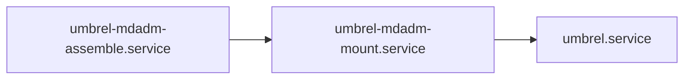
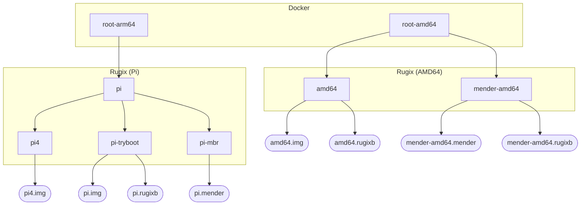

# umbrelOS

## GPU acceleration

The amd64 image keeps GPU userspace in application containers while providing
the host kernel interfaces those runtimes require:

| Hardware/backend | Host support | Container support |
| --- | --- | --- |
| AMD Vulkan | In-tree `amdgpu`, `/dev/dri` | Mesa/RADV |
| AMD ROCm | In-tree `amdgpu`/KFD, `/dev/kfd` and `/dev/dri` | ROCm/HIP |
| NVIDIA Vulkan | NVIDIA open kernel module, Vulkan ICD, NVIDIA Container Toolkit | Vulkan application/runtime |
| NVIDIA CUDA | NVIDIA open kernel module, `libcuda`, NVIDIA Container Toolkit | CUDA runtime |
| NVIDIA video | NVIDIA open kernel module, NVDEC/NVENC libraries, NVIDIA Container Toolkit | Video application/runtime |

NVIDIA's Vulkan, CUDA, and video implementations share the NVIDIA kernel driver
and can be used simultaneously. They coexist with AMDGPU and RADV on mixed-GPU
systems; the Vulkan loader selects the ICD matching each device. Containers
using NVIDIA Vulkan must request the `graphics` NVIDIA driver capability,
expose `/dev/dri`, and include the Vulkan and GLVND EGL loaders (`libvulkan1`
and `libegl1` on Debian-based images). Containers using NVDEC or NVENC must
request the `video` NVIDIA driver capability and include a compatible video
application such as FFmpeg.

An image that only needs Vulkan acceleration on NVIDIA hardware can set the
`NVIDIA_CUDA_SUPPORT=false` build argument to omit the NVIDIA host packages and
use the in-tree `nouveau` driver with containerized Mesa/NVK instead. NVK cannot
drive a GPU while that GPU is bound to the NVIDIA kernel driver.


## Linux RAID (mdadm)

Alongside ZFS, the image ships classic Linux software RAID via `mdadm`. Arrays
are managed by the `hardware.mdadm` module in `packages/umbreld`, created from
**Settings > Storage Manager**, and surfaced in Files under `/Raid`.

### Packages

Added to `umbrelos.Dockerfile` in the *Filessystem support* layer:

| Package | Provides |
| --- | --- |
| `mdadm` | `/dev/mdX` arrays, superblock metadata, `mdadm --monitor` |
| `btrfs-progs` | `mkfs.btrfs` |
| `xfsprogs` | `mkfs.xfs` |

The image already had `e2fsprogs` (ext4), `exfatprogs` (exFAT), `dosfstools`
(FAT32) and `ntfs-3g` (NTFS, amd64 only), which completes the set of filesystems
an array can be formatted with.

The final `update-initramfs -u -k all` in the image picks up mdadm's initramfs
hook, so arrays that are part of the boot path are available in early boot.

### Boot ordering



Both units are `oneshot`, enabled through `multi-user.target.wants`, and declare
us as ordering only (`After`/`Before`), never as a hard requirement — a host
without arrays boots exactly as before.

1. **assemble** — `mdadm --assemble --scan --run` brings every array defined by a
   superblock or `mdadm.conf` back online, then refreshes `/etc/mdadm/mdadm.conf`.
2. **mount** — `mount -a` replays the desired mounts from `/etc/fstab`, then starts
   `mdadm --monitor --scan --daemonise` for ongoing event monitoring.

`Mdadm.start()` in umbreld also runs a best-effort `assemble --scan --run`, so
arrays come back in containers and dev environments where the units never ran.
The inventory is then polled every 10 seconds into a cache, which is what
`Files` reads to populate `/Raid` — no shell-out per Files request.

### Mount persistence

`mount()` writes one `/etc/fstab` entry per array, keyed by **filesystem UUID**
rather than the device node:

```
UUID=<fs-uuid> /run/mdadm/umbrel-md ext4 nofail,x-mount.mkdir=0755 0 0
UUID=<fs-uuid> /run/mdadm/media exfat nofail,x-mount.mkdir=0755,uid=1000,gid=1000,umask=007 0 0
```

- `nofail` means an absent or degraded array is a warning, not a boot failure.
- UUID survives the array being reassembled onto a different `/dev/mdN`.
- The mountpoint directory is the **array name** from the superblock (sanitised,
  falling back to the device node name), so `/Raid/<name>` and the on-disk mount
  path agree and both survive md device renumbering.
- `x-mount.mkdir=0755` lets the boot-time `mount -a` recreate the mountpoint
  directory, since `/run/mdadm` is tmpfs and is empty after every reboot.
- Native filesystems (ext4/btrfs/xfs) mount bare; synthetic-ownership
  filesystems (exFAT/FAT32/NTFS) carry `uid`/`gid`/`umask` so files stay writable
  by the `umbrel` user, matching `isSyntheticOwnershipFilesystem()` semantics.

`unmount()` removes the entry again. `format()` refuses a mounted device, so an
array that is fstab-backed cannot be reformatted underneath a live mount.

`/run/mdadm` is tmpfs and is recreated by the mount unit; the array mounts
themselves only survive a reboot because `/etc/fstab` does.

### Files integration

`/Raid` is a `BaseDirectory` backed by `Mdadm.MOUNT_ROOT`, indexed like
`/External` (`scanEnabled: false`, on-demand entries only). It participates in:

- `getStorageDestination()` — `/Raid` paths are valid Cloud destinations, the same
  way `/External` and `/Network` are.
- `cloud.ts` shared-destination deletes — a sync rooted inside an array is
  recognised as valid.
- Member share categorisation — `/Raid/...` shares report base `raid` instead of
  falling back to `home`.
- `files.unmountRaidMount()` — blocks apps, machines and Cloud paths, excludes the
  path from Samba shares, then detaches and drops the fstab entry.

### Supported configurations

| RAID level | Min devices | Online growth |
| --- | --- | --- |
| 0 | 2 | no |
| 1 | 2 | no |
| 5 | 3 | yes (`growAddAndExpand`) |
| 6 | 4 | yes (`growAddAndExpand`) |
| 10 | 4 | no (even count required) |

Level migration (`grow({level})`) and post-replacement capacity reclamation
(`grow({sizeMax: true})`) are available for all levels. Reshape and resync
progress is parsed from `/proc/mdstat` and reported as `syncAction`/`syncProgress`.

### Testing

- `packages/umbreld/source/modules/hardware/mdadm.unit.test.ts` — parsers for
  `/proc/mdstat` and `mdadm --detail`, device allocation, filesystem catalogue.
- `packages/umbreld/source/modules/hardware/mdadm.vm.test.ts` — full lifecycle on
  a real VM: create RAID1, format, mount, verify `/Raid`, **reboot**, confirm data
  survives and the array stays healthy, unmount, stop.

```sh
npm --prefix packages/umbreld run test -- mdadm.unit.test
npm --prefix packages/umbreld run test:vm -- mdadm.vm.test.ts
```


## Build Process

The following diagram visualizes the build process and possible build artifacts:



### OS Variants

There are three main umbrelOS *variants*:

- `umbrelos-pi`: Rugix-native umbrelOS for Raspberry Pi.
- `umbrelos-amd64`: Rugix-native umbrelOS for AMD64.
- `umbrelos-mender-amd64`: Rugix-based but Mender-compatible umbrelOS for AMD64.

> [!IMPORTANT]
> **Legacy devices provisioned with Mender require the `umbrelos-mender-amd64` variant.** This variant includes a Rugix configuration to enable a safe migration from Mender to Rugix. Rugix will interface with GRUB in the same way Mender does to facilitate A/B switching. In addition, a Rugix hook is installed to migrate state into Rugix's state management mechanism. This enables factory resets and all other Rugix state management features.

### Build Artifacts

The build process can produce the following artifacts.

#### Images

Images for provisioning new umbrelOS devices.

- `umbrelos-amd64.img`: Image for provisioning AMD64 devices and VMs.
- `umbrelos-pi.img`: Image for provisioning Raspberry Pi devices (GPT-based).
- `umbrelos-pi4.img`: Optional image for provisioning Raspberry Pi 4 devices (GPT-based).

The image for Raspberry Pi 4 includes a firmware update to enable the `tryboot` mechanism used for A/B switching. Otherwise, the image is identical to the image for Raspberry Pi 5.

#### Mender Update Artifacts

Optional Mender update artifacts for updating existing systems through Mender:

- `umbrelos-pi.mender`: Mender update artifact for Raspberry Pi.
- `umbrelos-mender-amd64.mender`: Mender update artifact for AMD64 devices.

The update artifact for Raspberry Pi works for Raspberry Pi 4 and 5.

#### Rugix Update Bundles

For each of the umbrelOS variants, there is a respective Rugix update bundle:

- `umbrelos-pi.rugixb`: Rugix update bundle for Raspberry Pi.
- `umbrelos-amd64.rugixb`: Rugix update bundle for Rugix-native AMD64 devices.
- `umbrelos-mender-amd64.rugixb`: Rugix update bundle for legacy Mender devices.


## Mender to Rugix Migration

Devices can be migrated to Rugix by installing the respective Mender update artifact.

### Raspberry Pi

As umbrelOS for Raspberry Pi has always been based on Rugix, no special migration is needed.

### AMD64

In case of Mender-based AMD64 devices, the directory structure on the data partition must be migrated such that Rugix's state management can be used.
This migration is performed by a `boot/post-init` Rugix hook: [`10-migrate-state.sh`](./rugix/recipes/setup-rugix-mender/files/migrate-state.sh).
This hook works as follows: Initially, a symlink `/data/umbrel-os` is placed in the `/data` directory managed by Rugix linking back to the bare data partition.
This way, after booting, all the bind mounts to `/data/umbrel-os` are set up correctly.
The migration hook replaces this symlink atomically with the directory from the data partition, **but only after the system has been committed**.
This is done to leave the state intact, in case there is a rollback.
Note that the system needs to be rebooted once after the commit to trigger the migration.
To this end, after committing, `umbreld` may check whether `/data/umbrel-os` is a symlink and reboot the system if it is.


## Factory Resets

Factory resets can be triggered through Rugix Ctrl's state management mechanism as usual.
To trigger a factory reset, run `rugix-ctrl state reset`.
This will reboot the system and remove the state on the data partition in the process.
In case of a RAID configuration, a [`state-reset/prepare` hook](./rugix/recipes/setup-rugix/files/factory-reset.sh) is used to remove the RAID configuration and reset the main data partition.
Note that Rugix only supports resetting the state on the actively used data partition (which is the RAID, if a RAID has been configured), hence, we need to use the hook here to make sure that the main data partition is wiped as well.

Removing state can take some time during the boot process.
It is therefore recommended to use Rugix's state reset mechanism with the `--backup` flag.
This will simply rename the old state directory according to the following pattern:

```
/run/rugix/mounts/data/state/default -> /run/rugix/mounts/data/state/default.XXXXXXXXXXXXXX
```

Here, `XXXXXXXXXXXXXX` is the date and time of the reset.
The residual state can then removed after booting by `umbreld`.
